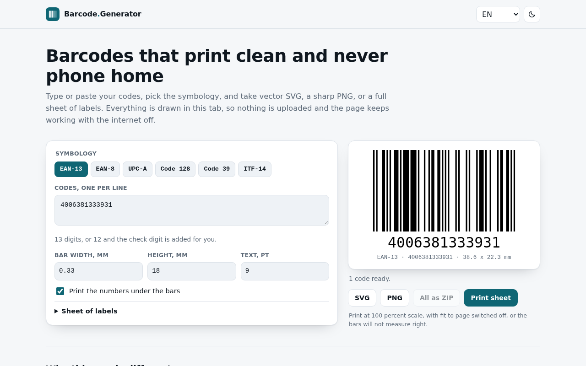

# Barcode Generator

**Bars that print clean, and nothing leaves the tab.**

[](https://tekideki.github.io/Barcode-Generator/)
[](LICENSE)



Six symbologies, one page, no account: EAN-13, EAN-8, UPC-A, ITF-14, Code 128 and Code 39. Type or paste the codes, check the preview, and take vector **SVG**, a **PNG** at 300 dpi, or a whole **A4 sheet of labels** with the numbers underneath.

Everything is computed and drawn by the page itself. No server sees a product code, and the tool keeps working with the network off.

## What it does

- **Six symbologies.** Retail units (EAN-13, EAN-8, UPC-A), cartons (ITF-14), shipping and assets (Code 128, Code 39).
- **Check digits handled.** Type 12 digits and the thirteenth is worked out for you. Type a wrong one and it is corrected, with the change stated on screen.
- **Millimetres, not pixels.** Bar width and height are typed in millimetres, so the symbol measures the same on screen and on paper. The caption shows the printed size.
- **SVG, PNG, ZIP.** One code at a time, or every code in the list as a zipped folder of SVGs.
- **A sheet at once.** Paste a list, choose the label size, print. The bars scale down to fit the label, the page stays A4.
- **Four languages.** English, Romanian, Serbian Latin and Serbian Cyrillic, remembered between visits.
- **Works offline.** Install it and it opens with the network off.

## How to use it

1. Pick the symbology.
2. Type a code, or paste one per line.
3. Check the caption for the printed size.
4. Take the **SVG** for a print shop, the **PNG** for a screen, or **Print sheet** for a run of labels.
5. Print at 100 percent, with "fit to page" switched off.

## Why it is built this way

**No network at all.** One HTML file, no external request. The browser test checks that no request leaves the page while it works.

**No third party code.** The six encoders are in `src/barcode.js`, written from the symbology specifications. The test suite compares them against JsBarcode, an independent implementation, over 1,350 vectors, and freezes the results in `tests/logic_test.cjs`.

**Deterministic build.** `python3 build.py` inlines the styles, the encoders and the three authored locales into `index.html`, and transliterates Serbian Cyrillic so it can never drift from the Latin version. No timestamps, no machine paths.

## Tests

```bash
node tests/logic_test.cjs          # 29 checks: encoders, check digits, locales
python3 tests/ui_test.py           # 35 checks in Chromium, server included
```

## Development

```bash
python3 build.py                   # writes index.html from src/
python3 -m http.server 8000        # then open http://localhost:8000
```

Sources live in `src/`: `barcode.js` (encoders), `app.js` (page), `styles.css`, `template.html`, `i18n/locales.json` (en, ro, sr-latn).

## Licence

Apache 2.0. See `LICENSE` and `NOTICE`.
